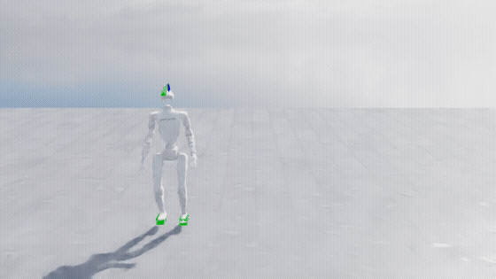
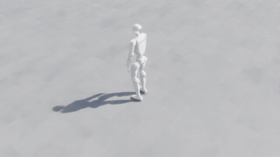

# SONIC + Perception Student (Unitree G1)

在 Unitree G1 人形机器人上做**双老师蒸馏**：学生以 NVIDIA **SONIC**（通用动作跟踪）为底座，同时向两个老师学习：

- **老师 1：SONIC**（官方 `sonic_release`，冻结），负责动作跟踪；
- **老师 2：InstinctLab 感知策略**（复现论文 *Hiking in the Wild* 训练出的 `model_30000.pt`，冻结），负责走复杂地形。

本仓库包含目前已完成的两部分工作：

1. **纯 InstinctLab 感知策略的推理与评估**（[`instinctlab_perception_inference/`](instinctlab_perception_inference/)）：play 回放视频、原版地形评估、按论文方式的 9 种地形评估，以及最高难度下 9 种地形的关节运动数据。这一部分不涉及 SONIC。
2. **第零阶段初步实验**（[`stage0_sonic_two_teachers/`](stage0_sonic_two_teachers/)）：把 SONIC 从官方框架中拆出来，和感知老师放进同一个 InstinctLab 仿真环境，验证两个老师各自工作正常。

> 目前**还没有开始训练学生**，下一步是第 1 阶段 DAgger（见[第 6 节](#6-下一步第-1-阶段-dagger)）。

---

## 目录

- [1. 结论速览](#1-结论速览)
- [2. 视频](#2-视频)
- [3. 第一部分：纯 InstinctLab 感知策略的推理与评估](#3-第一部分纯-instinctlab-感知策略的推理与评估)
- [4. 第二部分：第零阶段——两个老师接进同一环境](#4-第二部分第零阶段两个老师接进同一环境)
- [5. 实验方案：以 SONIC 为底的双老师蒸馏](#5-实验方案以-sonic-为底的双老师蒸馏)
- [6. 下一步：第 1 阶段 DAgger](#6-下一步第-1-阶段-dagger)
- [7. 仓库结构](#7-仓库结构)
- [8. 如何运行](#8-如何运行)
- [9. 踩坑记录](#9-踩坑记录)
- [10. 未包含的文件与依赖](#10-未包含的文件与依赖)

---

## 1. 结论速览

**纯 InstinctLab 感知策略（`model_30000.pt`）**
- 在原版训练地形上工作正常：61612 个回合，总摔倒率 **1.9%**；评估结束时平均地形等级 6.18，训练结束时是 6.03。
- 按论文方式评估（每种地形 1000 个机器人、最高难度、10000 步）：起伏、缺口、上台阶、上平台 **≥ 99.76%，基本复现**；下平台 99.42%、下台阶 98.36%，略低；**Large Box 95.85%、Small Box 79.52%、Ramp 84.49%，明显低于论文的 100 / 99.09 / 100**。到达时间和论文在同一量级（约 5 s）。
- `model_3000.pt`（10% 训练量）动作明显发抖，`model_30000.pt` 稳定得多。
- 已录下 **9 种地形 × 10 个机器人 × 20 s** 的关节运动数据（最高难度第 9 级）。

**第零阶段（两个老师接进同一环境）**
- **PyTorch 重写的 SONIC 和官方 ONNX 一致**：token 误差为 0，动作误差约 5e-6。
- **最大的坑：InstinctLab 机器人腰部 3 个关节（yaw/roll/pitch）的正负号和 SONIC 相反**。不修正时 13 条动作全部摔倒，修正后恢复正常。
- **SONIC 换到感知老师的机器人上照样能跟踪**：13/13 成功，平均误差 31.2 mm；在 SONIC 自己的执行器下是 29.2 mm。
- **两个老师在同一个环境里各自正常**：感知老师在 9 种地形上的表现和之前的评估一致；SONIC 在平地上平均误差 29.7 mm，没有摔倒；动作换算链路的误差是 2.4e-7。
- 共用环境定在 **InstinctLab（Isaac Lab 2.1）这一侧**。用缩小的地形时，8 GB 显存的笔记本能跑。

---

## 2. 视频

### 纯 InstinctLab 感知策略 `model_30000.pt`（Play 版地形，1 个机器人，10 s）



原视频（1280×720，50 fps）：[`instinctlab_perception_inference/videos/model_30000_play_1env.mp4`](instinctlab_perception_inference/videos/model_30000_play_1env.mp4)
对比：第 3000 次迭代的模型（动作明显发抖）[`model_3000_play_1env.mp4`](instinctlab_perception_inference/videos/model_3000_play_1env.mp4)

> 视频用的是 Play 版任务 `Instinct-Parkour-Target-Amp-G1-Play-v0`（4×10 块地形、无围墙、回合 10 s），不是训练用的原版地形：原版的 200 块地形在 8 GB 显存的笔记本上放不下。

### 第零阶段：两个老师在同一个 InstinctLab 环境里（70 s，GIF 为 4 倍速）



原视频（1280×720，50 fps）：[`stage0_sonic_two_teachers/results_stage0/video_final/videos/stage0_two_teachers-step-0.mp4`](stage0_sonic_two_teachers/results_stage0/video_final/videos/stage0_two_teachers-step-0.mp4)

| 时间 | 控制者 | 内容 |
|---|---|---|
| 0–10 s | SONIC | walking_quip_360（边走边转身） |
| 10–20 s | SONIC | dance_in_da_party（跳舞） |
| 20–30 s | SONIC | tired_one_leg_jumping（单腿跳） |
| 30–40 s | 感知老师 | 上台阶，最高难度 |
| 40–50 s | 感知老师 | 缺口 |
| 50–60 s | 感知老师 | Small Box |
| 60–70 s | 感知老师 | Ramp |

录像版去掉了地形四周 5 m 高的围墙，否则跟拍相机会嵌进墙里。SONIC 段从侧后方跟拍，地形段从斜上方俯拍。

---

## 3. 第一部分：纯 InstinctLab 感知策略的推理与评估

训练在 AutoDL（RTX 4090）上完成：任务 `Instinct-Parkour-Target-Amp-G1-v0`，4096 个环境，30000 次迭代。和上游配置相比唯一的改动是 `save_interval=1000`。以下推理和评估都**不改任何上游代码和训练配置**，只新写了评估脚本。详细记录见 [`README_2026-09-24_play与评估.md`](instinctlab_perception_inference/README_2026-09-24_play与评估.md)。

### 3.1 Play 回放（本地笔记本渲染）

| 视频 | 内容 |
|---|---|
| [`videos/model_3000_play_1env.mp4`](instinctlab_perception_inference/videos/model_3000_play_1env.mp4) | 第 3000 次迭代，1 个机器人，10 s，动作明显发抖 |
| [`videos/model_30000_play_1env.mp4`](instinctlab_perception_inference/videos/model_30000_play_1env.mp4) | 最终模型，设置相同，稳定得多 |

Play 版和原版地形的区别：

| | 原版（训练、评估用） | Play 版（视频用） |
|---|---|---|
| 地形网格 | 10 × 20 = 200 块 | 4 × 10 = 40 块 |
| 围墙 | 有（`wall_prob=0.3`） | 全部去掉 |
| `root_height` 摔倒判定 | 开 | 关 |
| 回合长度 | 20 s | 10 s |
| 摩擦力随机化、关节初始扰动 | 开 | 关 |

AutoDL 上 Isaac Sim 4.5 的渲染器会段错误，所以视频只能在本地录；本地显存放不下原版地形，所以只能用 Play 版。录制日志在 `play_logs/`。

### 3.2 原版地形评估（`eval/eval_full.py`）

使用原版任务的默认配置：200 块地形、带围墙、开启课程学习、启用全部终止条件，4096 个机器人，策略用确定性推理。摔倒 = `base_contact` / `bad_orientation` / `root_height`；`time_out` / `terrain_out_bound` 算正常结束。

跑了两次：**3000 步**时课程学习只爬到 0–5 级，摔倒率 1.3%，不能代表最难的地形；**15000 步**时爬到和训练结束相当的等级，覆盖 0–9 级，**以这次为准**。

15000 步的结果：总计 61612 个回合，摔倒 1181 次（**1.9%**）。其中 `root_height` 864 次、`bad_orientation` 234 次、`base_contact` 83 次。

| 论文地形 | 代码子地形 | 全部等级摔倒率 | 8–9 级摔倒率 | 平均位移 (m) |
|---|---|---|---|---|
| Rough | perlin_rough | 0.13% | 0.3% | 2.69 |
| Gap | square_gaps | 0.42% | 0.1% | 3.65 |
| Stair down | pyramid_stairs | 0.27% | 0.9% | 3.64 |
| Platform down | pyramid_stairs_high | 0.10% | 0.2% | 3.65 |
| Stair up | pyramid_stairs_inv | 0.02% | 0% | 3.66 |
| Platform up | pyramid_stairs_inv_high | 0.05% | 0% | 3.64 |
| Large Box | boxes | 3.1% | 6.2% | 2.62 |
| **Small Box** | **mesh_boxes** | **10.8%** | **15.2%** | 2.52 |
| **Ramp** | **hf_pyramid_slope_inv** | **4.1%** | **10.5%** | 2.47 |
| （原地站立指令） | perlin_rough_stand | 0% | 0% | 0.34 |

按难度等级：0–5 级摔倒率 0.8%–1.7%，6–7 级约 1.8%，8 级 3.3%，9 级 3.9%。平均位移指回合结束时离出生点的直线距离，受 8 m × 8 m 地块大小的限制。

结果文件：`eval/results_15k/`（主结果，含每个回合的明细 `_episodes.npz`）、`eval/results_3k/`（仅供参考）。

### 3.3 按论文方式评估（`eval/eval_paper.py`，以此为准）

每种地形单独放 **1000 个机器人**，全部固定在**最高难度（第 9 级）**，关闭课程学习，跑 **10000 步**（200 s，约 10 个回合）。分三批跑，每批 3 种地形，在 4090 上每批约 25 分钟。

- **回合成功率** = 1 − 以摔倒结束的回合比例（主口径）
- **机器人成功率** = 10000 步内一次都没摔过的机器人比例（更严格）
- **到达时间** = 从分配目标点到第一次进入目标 0.4 m 以内的时间，只统计到达了的目标

| 论文地形 | 代码子地形 | 论文成功率 | **回合成功率** | 机器人成功率 | 论文到达时间 (s) | 我们的到达时间 (s) |
|---|---|---|---|---|---|---|
| Rough | perlin_rough | 100.0 | **99.95** | 99.5 | 5.40 | 5.13 |
| Gap | square_gaps | 100.0 | **99.76** | 98.2 | 5.43 | 4.59 |
| Stair down | pyramid_stairs | 99.95 | **98.36** | 86.4 | 4.45 | 4.96 |
| Platform down | pyramid_stairs_high | 100.0 | **99.42** | 94.6 | 5.48 | 5.17 |
| Stair up | pyramid_stairs_inv | 100.0 | **99.99** | 99.9 | 5.35 | 5.65 |
| Platform up | pyramid_stairs_inv_high | 100.0 | **99.97** | 99.7 | 5.45 | 5.13 |
| Large Box | boxes | 100.0 | **95.85** | 66.8 | 5.50 | 5.15 |
| Small Box | mesh_boxes | 99.09 | **79.52** | 12.9 | 8.03 | 5.27 |
| Ramp | hf_pyramid_slope_inv | 100.0 | **84.49** | 22.8 | 5.84 | 5.49 |

**结论**
- 起伏、缺口、上台阶、上平台 4 类复现得很好，和论文最多差 0.24 个百分点。下平台和下台阶略低，差 0.6–1.6 个百分点。
- Large Box / Small Box / Ramp 在最高难度下明显低于论文，方向和课程评估一致（课程评估里这三类是 96.9 / 89.2 / 95.9），只是固定在最难一级时差距更大。
- 到达时间整体和论文在同一量级（4.6–5.7 s，论文是 4.45–5.84 s）。Small Box 我们是 5.27 s，比论文的 8.03 s 短，但这一类有大量机器人中途摔倒，只统计到达的目标会有幸存者偏差。

**口径上的不确定**：论文没有写清“成功”怎么定义，也没有写评估用哪个难度等级。如果论文用的是较低难度，Box / Ramp 的差距会小很多。我们只训练了一个种子，也没有做挑选。论文提到基础策略之后还针对高速奔跑和部分地形做过 post-training，这部分没有公开。

结果文件：`eval/results_paper/`（3 个 JSON，每个包含 3 种地形；`_raw.npz` 是每个回合和每个目标点的明细；`evalpaper.log` 是服务器日志）。

### 3.4 9 种地形的关节运动数据推理（`eval/record_joints.py`）

设置和 `eval_paper.py` 相同：原版任务配置、关闭课程学习、每种地形单独一组机器人、固定在第 9 级。本地显存放不下原版的 200 块地形，所以用**紧凑地形**：只生成要录的地形类型，每种 1 列、10 行，地块的几何参数和难度公式与训练时相同。

`model_30000.pt`，每种地形 10 个机器人，1000 步（20 s，50 Hz）。20 s 内的摔倒次数：

| 起伏 | 缺口 | 下台阶 | 下平台 | 上台阶 | 上平台 | Large Box | Small Box | Ramp |
|---|---|---|---|---|---|---|---|---|
| 0 | 1 | 0 | 1 | 0 | 0 | 0 | **4** | **2** |

**数据格式**（`joint_data/model_30000_L9/`，约 59 MB）
- `joints_model_30000_<地形>_L9.npz`：数组形状都是 `[1000 步, 10 机器人, ...]`
  - `joint_pos` / `joint_vel` / `joint_pos_target` / `applied_torque` / `actions`（29 个关节）
  - `root_pos_w` / `root_quat_w`（w,x,y,z）/ `root_lin_vel_b` / `root_ang_vel_b`
  - `command` / `done` / `fell` / `episode_id`，以及 `joint_names` / `default_joint_pos` / `time_s`
- `csv/<地形>_L9_robot0.csv`：每种地形 1 个机器人的 CSV（时间、根位姿、q、dq、力矩）
- `joints_model_30000_L9_meta.json`：运行设置和摔倒统计；日志在 `joint_data/record_L9.log`

**使用注意**
- 第 t 帧是第 t 步执行**之后**的状态。`done=True` 的那一帧已经是下一回合的出生姿态，请按 `episode_id` 切分。
- 关节顺序是 InstinctLab 机器人的顺序，以 `joint_names` 为准。
- **根节点是躯干（torso），不是骨盆**；**腰部 3 个关节的符号和标准 G1 / SONIC 相反**。和其他数据对照时需要换算，可以用 `stage0_sonic_two_teachers/bridge.py`。

---

## 4. 第二部分：第零阶段——两个老师接进同一环境

详细记录见 [`README_2026-10-10_关节数据与第零阶段.md`](stage0_sonic_two_teachers/README_2026-10-10_关节数据与第零阶段.md)。

### 4.1 PyTorch 重写 SONIC（`sonic_net.py`）

- 动作网络共 2590 万参数：3 个编码器（g1 / teleop / smpl，MLP 2048-1024-512-512）→ FSQ（每个 token 32 维 × 32 级，共 2 个 token）→ 解码器 `g1_dyn`（token 64 维 + 本体感知 930 维 → 29 维动作）。
- g1 编码器的输入（640 维）：未来 10 帧参考动作的关节角和关节速度，加上参考骨盆相对机器人骨盆的 6D 旋转。
- 本体感知（930 维）：10 帧历史，包括骨盆角速度、关节角、关节速度、上一步动作、重力方向。
- **和官方 ONNX 比对（`verify_vs_onnx.py`）**：token 完全一致，动作误差约 5e-6。

### 4.2 两边机器人配置对比（`cmp_actuators.py`）

| | InstinctLab（感知老师） | SONIC |
|---|---|---|
| URDF | 根节点 = 躯干，带鞋（+5.8 cm） | 根节点 = 骨盆 |
| 执行器 | 延迟 PD（≤ 10 ms） | 隐式 PD，无延迟 |
| PD 常数、动作缩放、默认站姿 | 相同 | 相同 |
| 唯一的参数差异：髋关节俯仰 | 刚度 40.2，88 Nm | 刚度 99.1，139 Nm |

### 4.3 腰部符号问题（关键）

- **现象**：复位后关节角完全一致，但骨盆偏了 18 mm，误差沿着腿逐级放大（髋 57 → 膝 155 → 踝 255 mm），13 条动作全部摔倒。
- **原因**：InstinctLab 的模型以躯干为根，腰部运动链方向相反（躯干 → 腰 → 骨盆），所以关节角的正负号也反了。
- **验证**：逐一测试了 8 种符号组合。**3 个腰关节全部取反**时复位误差从 70 mm 降到 1.5 mm，其余组合是 9–68 mm。
- 这个修正已写进 `bridge.py`，默认取反。

### 4.4 SONIC 在 InstinctLab 中的跟踪结果（`track_sonic_in_instinct.py`）

13 条官方示例动作，平地。MPJPE-L = 14 个身体点相对骨盆的位置误差。

| 配置 | 平均 MPJPE-L | 平均关节误差 | 成功 |
|---|---|---|---|
| 不穿鞋 + SONIC 执行器 | 29.2 mm | 5.6° | 13/13 |
| 不穿鞋 + InstinctLab 执行器 | 30.2 mm | 6.0° | 13/13 |
| 穿鞋 + SONIC 执行器 | 29.7 mm | 5.7° | 13/13 |
| **穿鞋 + InstinctLab 执行器（共用环境）** | **31.2 mm** | 6.1° | 13/13 |

影响主要来自执行器（髋俯仰更软，加上延迟），鞋子只多出约 0.5 mm。结论：共用环境可以直接用感知老师的机器人，不需要为 SONIC 改配置。逐条结果见 `results_track/`。

### 4.5 两个老师在同一个环境里（`stage0_two_teachers.py`）

- 地形组：9 种地形 × 8 个机器人，第 9 级，由感知老师用它自己的观测（本体感知 + 深度相机）控制。
- 平地组：13 个机器人，每个跟踪一条示例动作，由 SONIC 控制（经 `bridge.py` 换算动作）。
- 两组共用同一个 `env.step()`，跑 2000 步（40 s）。

| 地形 | 感知老师 成功/回合 | 之前的评估（每种 1000 个机器人） |
|---|---|---|
| 起伏、上下台阶、上下平台、Large Box | 各 16/16 | 95.85–99.99% |
| 缺口 Gap | 15/16 | 99.76% |
| Small Box | 13/16 | 79.52% |
| Ramp | 13/16 | 84.49% |

- **SONIC**：平均误差 29.7 mm，按它自己的判据 0 次摔倒，共完整播完 44 遍动作。
- **动作换算链路**：环境实际收到的关节目标和 SONIC 输出的目标，最大差 2.4e-7。
- **发现的问题**：InstinctLab 环境的终止条件是为走路设计的（躯干离地低于 0.5 m、姿态过斜等），所以下蹲、弓步这类动作即使 SONIC 跟踪正常也会被判定结束。DAgger 里的动作跟踪环境需要关掉这些终止条件，改用跟踪误差来判定失败。

结果文件：`results_stage0/stage0_two_teachers_L9.json`。

---

## 5. 实验方案：以 SONIC 为底的双老师蒸馏

**目标**：学生保留 SONIC 的通用动作跟踪能力，同时从感知老师学会走复杂地形。

```
参考动作 → [g1 编码器（冻结）]               ─┐
                                               ├→ FSQ token → [SONIC 解码器] → 29 维关节动作
指令 + 地形感知 + 本体感知 → [新地形编码器]   ─┘                ↑ 本体感知（10 帧历史）

平地动作跟踪回合：走 g1 编码器，标签 = SONIC 老师   （防止遗忘动作跟踪）
地形回合：       走新编码器，   标签 = 感知老师      （学会过地形）
训练方式：在线 DAgger；两个老师的动作都先换算成同一套关节目标角再算损失
```

| 阶段 | 内容 | 训练哪些参数 |
|---|---|---|
| 0（已完成） | 两个老师接进同一个环境，验证各自正常 | 不训练 |
| 1 | 小感知分支（高度扫描 → 小 MLP） | 只训练新编码器，解码器冻结 |
| 2 | 加大感知网络并加入深度图，新增部分零初始化 | 新编码器；解码器用小学习率放开 |
| 3（可选） | PPO + DAgger 损失正则 | 全部 |

**对照组**：SONIC 原版（看不见地形）、感知老师（地形表现的上限）、只用感知老师的学生（检验是否会遗忘动作跟踪）、一开始就用大感知网络、阶段 2 解码器冻结 vs 放开。

**评估**：9 种地形最高难度下的成功率和到达时间（沿用 `eval_paper.py` 的口径）；SONIC 示例动作上的 MPJPE 和成功率；关节加速度、抖动。

**为什么共用环境选在 InstinctLab 这一侧**：SONIC 训练代码用的是 Isaac Lab 2.3.x，InstinctLab 用的是 Isaac Lab 2.1.0，在线 DAgger 要求两边在同一个仿真里。感知老师的深度相机是 InstinctLab 自己写的传感器，移植到 2.3 很麻烦；SONIC 需要搬过来的只有几个 MLP + FSQ、本体感知观测和参考动作播放，这些都已经完成。

---

## 6. 下一步：第 1 阶段 DAgger

1. 学生 = SONIC（g1 编码器 + 解码器，冻结）+ 新的地形移动编码器（指令 + 高度扫描 + 本体感知，小 MLP，输出到 FSQ token 空间）。
2. 环境由学生控制：地形环境用感知老师的动作做标签，平地跟踪环境用 SONIC 老师的动作做标签。前期按一定概率执行老师的动作，这个比例逐步降到 0。
3. 平地跟踪环境关掉走路用的终止条件，改用跟踪误差判定失败。
4. 先在笔记本上用少量环境跑通，再上 AutoDL 正式训练。

---

## 7. 仓库结构

```
.
├── README.md                              # 本文件
├── media/                                 # README 里的 GIF 预览
├── instinctlab_perception_inference/      # 第一部分：纯 InstinctLab 感知策略的推理与评估
│   ├── README_2026-09-24_play与评估.md     #   详细记录（play 视频 + 地形评估 + 排查过程）
│   ├── run_instinct.ps1                   #   本地运行包装脚本（清掉 user-site，避免导入别的 isaaclab）
│   ├── videos/                            #   play 视频：model_3000 / model_30000
│   ├── play_logs/                         #   本地录视频的日志
│   ├── eval/
│   │   ├── eval_full.py                   #   原版地形评估脚本
│   │   ├── eval_paper.py                  #   按论文方式评估的脚本
│   │   ├── record_joints.py               #   关节运动数据录制脚本
│   │   ├── results_15k/  results_3k/      #   原版地形评估结果
│   │   └── results_paper/                 #   按论文方式的评估结果
│   ├── joint_data/model_30000_L9/         #   9 种地形关节数据（npz + csv + meta）
│   └── joint_data_smoke.log
└── stage0_sonic_two_teachers/             # 第二部分：第零阶段初步实验
    ├── README_2026-10-10_关节数据与第零阶段.md
    ├── sonic_net.py                       #   PyTorch 版 SONIC（编码器 + FSQ + 解码器）
    ├── bridge.py                          #   SONIC ↔ InstinctLab：关节顺序、腰部取反、动作换算、参考动作播放
    ├── track_sonic_in_instinct.py         #   检查 1：平地跟踪测试
    ├── stage0_two_teachers.py             #   检查 2：两个老师同一环境（--video 录像）
    ├── verify_vs_onnx.py  dump_enc_graph.py      # 和官方 ONNX 比对
    ├── cmp_actuators.py  dump_actuators.py  act_*.json   # 两边执行器逐关节对比
    ├── sonic_release_config.yaml          #   SONIC 官方训练配置
    ├── ref_example/                       #   13 条官方示例参考动作（CSV，50 Hz）
    ├── results_track/                     #   检查 1 结果（4 种配置）
    ├── results_stage0/                    #   检查 2 结果 + 回放视频
    └── *.log                              #   各次运行日志（diag_*.log 是排查腰部问题时的诊断）
```

---

## 8. 如何运行

需要先装好 InstinctLab（Isaac Lab 2.1.0 / Isaac Sim 4.5）。本地命令都在 Windows PowerShell 中、`InstinctLab` 目录下执行。双显卡笔记本要先指定 NVIDIA 的 Vulkan：

```powershell
$icd = "C:\Windows\System32\DriverStore\FileRepository\<nvlti 驱动目录>\nv-vk64.json"
$env:VK_ICD_FILENAMES = $icd; $env:VK_DRIVER_FILES = $icd
```

**录 play 视频**（约占 3.9 GB 显存）
```powershell
& <repo>\instinctlab_perception_inference\run_instinct.ps1 "source\instinctlab\instinctlab\tasks\parkour\scripts\play.py" `
  --task=Instinct-Parkour-Target-Amp-G1-Play-v0 --load_run=<训练日志目录> `
  --checkpoint=model_30000.pt --num_envs=1 --headless --video --video_length=500
```

**原版地形评估**（服务器，4090 上约 40 分钟，显存约 20 GB）
```bash
python eval_full.py --task=Instinct-Parkour-Target-Amp-G1-v0 \
  --load_run=<训练日志目录> --checkpoint=model_30000.pt \
  --num_envs=4096 --steps=15000 --headless --out=<输出目录>
```

**按论文方式评估**（服务器，每批 3 种地形，约 25 分钟）
```bash
python eval_paper.py --task=Instinct-Parkour-Target-Amp-G1-v0 \
  --load_run=<训练日志目录> --checkpoint=model_30000.pt \
  --terrains boxes mesh_boxes hf_pyramid_slope_inv --envs_per_terrain 1000 --steps 10000 --headless
```

**录 9 种地形的关节数据**（本地，约 5 分钟）
```powershell
& <repo>\instinctlab_perception_inference\run_instinct.ps1 <repo>\instinctlab_perception_inference\eval\record_joints.py `
  --task=Instinct-Parkour-Target-Amp-G1-v0 --load_run=<训练日志目录> `
  --checkpoint=model_30000.pt --envs_per_terrain 10 --steps 1000 --level -1 --headless --csv --csv_robots 1 `
  --out=<输出目录>
```
`--level` 选择难度（0–9，-1 表示最难），`--terrains` 选择地形，`--full_terrain` 使用原版 200 块地形（需要服务器）。

**第零阶段：两个老师同一环境 + 录像**（需要 `sonic_release_policy_sd.pt`，见第 10 节）
```powershell
& <repo>\instinctlab_perception_inference\run_instinct.ps1 <repo>\stage0_sonic_two_teachers\stage0_two_teachers.py `
  --load_run=<训练日志目录> --checkpoint=model_30000.pt `
  --envs_per_terrain 1 --video --headless --out=<输出目录>
```
`--video_targets` 选择跟拍对象（`sonic:<动作名>` 或 `terrain:<地形名>`），`--segment_steps` 改每段的长度。

---

## 9. 踩坑记录

1. **腰部关节符号相反**：所有 SONIC ↔ InstinctLab 的转换都要经过 `bridge.py`。
2. **InstinctLab 机器人的根节点是躯干**：`root_pos_w` / `root_quat_w` 是躯干的位姿，SONIC 的观测要从 `pelvis` 这个 body 读。
3. **ONNX 编码器输入第 0 列是模式编号**，不是 one-hot；设成 1 会走 teleop 编码器。
4. **必须先启动 Isaac Sim（`AppLauncher`），再 import torch/numpy**，否则会报 `DLL load failed while importing _multiarray_umath`。
5. **`app.close()` 在本机无渲染运行后会卡住**：脚本结尾改用 `os._exit(0)`，结果要先写入文件。
6. **原版 200 块地形在 8 GB 显存上会爆**：本地用紧凑地形，正式训练和评估放到 AutoDL。
7. **AutoDL 上 Isaac Sim 4.5 的 RTX 渲染器会段错误**（IsaacLab 自带的空场景也一样），视频只能在本地录；不开渲染的训练和评估不受影响。
8. **容器里没有 X 服务器时，Vulkan ICD 要用 `libEGL_nvidia.so.0`**，不能用 GLX 入口。

---

## 10. 未包含的文件与依赖

**未包含**
- SONIC 官方动作网络权重 `sonic_release_policy_sd.pt`（约 104 MB）：超过 GitHub 单文件上限，而且属于 NVIDIA 官方发布。获取方法：在 SONIC 官方仓库中运行 `python download_from_hf.py --training --no-smpl` 得到 `sonic_release/last.pt`，取其中的 `policy_state_dict` 另存。
- 感知策略 checkpoint `model_30000.pt`，以及 InstinctLab / IsaacLab 源码。

**依赖**
- InstinctLab（Isaac Lab 2.1.0 / Isaac Sim 4.5）
- SONIC（NVIDIA GEAR）
- 参考论文：*Hiking in the Wild*（感知策略）、SONIC
